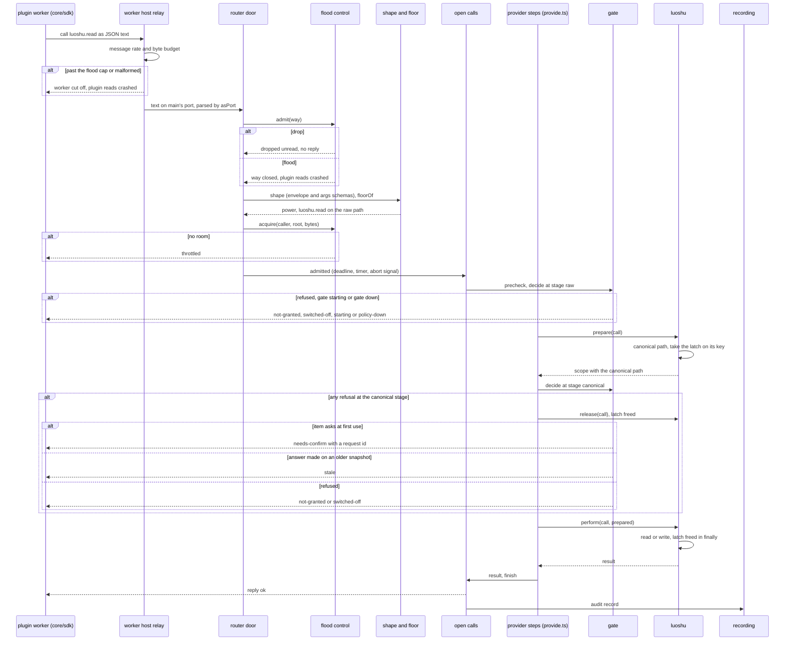
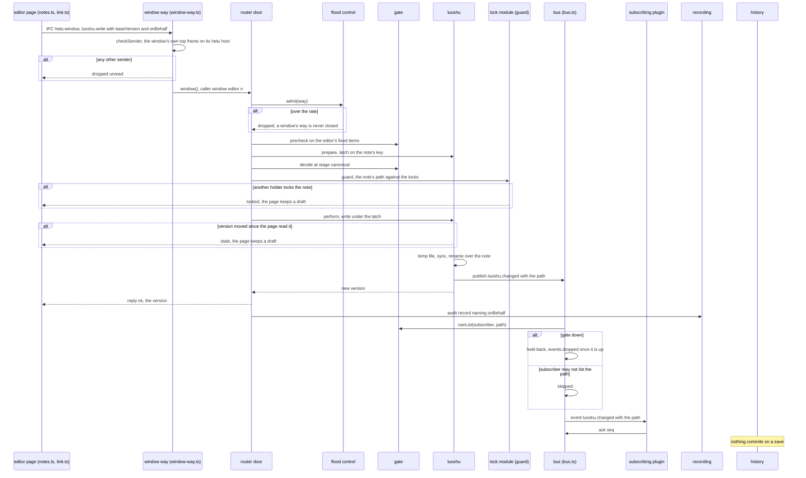
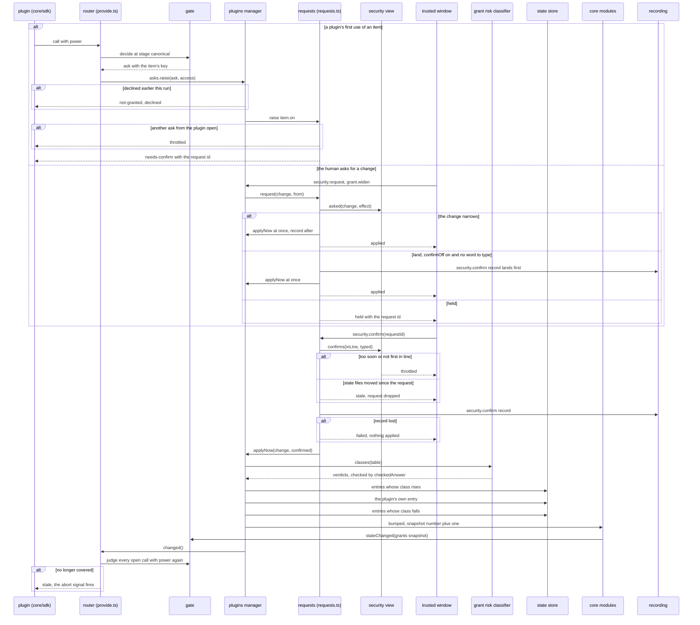
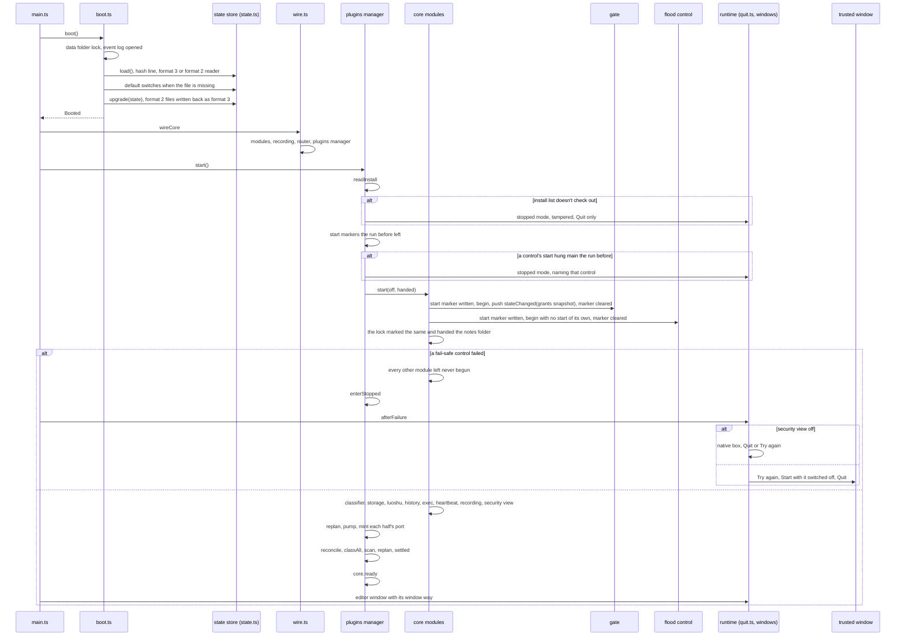
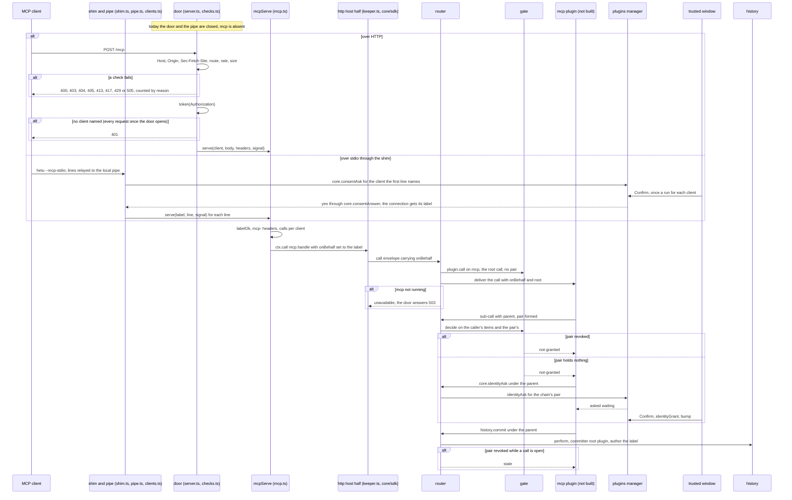

# hetu flows

Five paths through the core, drawn from the code as it is built. Each flow says what starts it and what ends it, shows a sequence diagram with the refusals that matter, lists the call path one step per line with `file:line` and gives the places a change to that path usually goes wrong.

Every path is relative to the repo root. Line numbers hold at commit `ff3e869`. A step marked **not built** is shown where the code leaves a gap.

- [How to read hetu's code](#how-to-read-hetus-code)
- [Flow 1: a plugin's call to a provider](#flow-1-a-plugins-call-to-a-provider)
- [Flow 2: the editor saving a note](#flow-2-the-editor-saving-a-note)
- [Flow 3: a grant change and its Confirm](#flow-3-a-grant-change-and-its-confirm)
- [Flow 4: boot to ready](#flow-4-boot-to-ready)
- [Flow 5: an MCP client's call under a pair](#flow-5-an-mcp-clients-call-under-a-pair)

## How to read hetu's code

### The `header.ts` door per folder

Each folder under `core/backend` that others depend on has a `header.ts` holding only types, interfaces and constants: what the module offers. The implementation sits beside it. Other folders import the header, never the implementation. This is an interface kept apart from its class, as a Java interface is, so tests can hand in a fake and the import rules can be checked.

Example: `core/backend/flood-control/header.ts:22` declares `FloodControl` (`admit`, `acquire`, `release`). `core/backend/flood-control/flood-control.ts:8` implements it in `createFloodControl`. The router reads only the header's types (`core/backend/router/context.ts:12`).

### `wire.ts` connecting parts that need each other

`core/backend/wire.ts` and `core/backend/main.ts` are the only files that import implementations and build the parts. Two parts that need each other can't both be built first, so `wireCore` keeps a `parts` holder whose fields start `null` and fills them as each part is built. The closures handed out read `parts.router?.…` at call time, not at build time.

Example: `core/backend/wire.ts:100` makes the holder. `:110` hands luoshu a publish closure that reaches the router once it exists. `:161` hands the router the plugins manager's table with `router.read(pluginsManager)`.

### zod schemas in `core/api` as the contract

`core/api` holds the data every part agrees on, written as zod schemas. A zod schema is a runtime parser: `schema.safeParse(value)` answers `{ success, data }` and never throws. Anything that crosses a trust boundary is parsed once at the edge by one of these schemas and read as typed data after.

Example: `core/api/envelope.ts:60` is `callEnvelope`, the exact fields of a call. The router parses every incoming call with it at `core/backend/router/shape.ts:26`. Each provider action's arguments have their own schema in the table at `core/api/actions.ts:222`, applied at `core/backend/router/shape.ts:47`.

### The grants snapshot

The plugins manager owns every grant. On each change it builds a numbered, frozen copy of what every plugin holds, the grants snapshot. It pushes that snapshot to the gate. The gate answers each decision with the number of the snapshot it decided on (`view`). The router refuses any answer whose number is not the current one, so a decision made on old grants never lets a call on.

Example: the shape is `GrantsSnapshot` at `core/api/policy-jobs.ts:138`. It is built at `core/backend/plugins-manager/changes.ts:229`, numbered by `n` in `bump` at `core/backend/plugins-manager/base.ts:496` and compared at `core/backend/router/provide.ts:99`.

### The abort signal on a call

Each open call holds an `AbortController` (`ended`). The call object handed to a provider or a plugin's handler carries its `signal`. It aborts when the call ends for any reason: answered, timed out, cancelled or revoked by a new grants snapshot. A provider that can stop listens to it, one that can't finishes and answers as it would.

Example: `core/backend/router/open-calls.ts:60` makes the controller in `admitted`. `finish` aborts it at `:115` and `revoke` at `:186`. `core/backend/providers/exec/exec.ts:195` kills a running command on it.

### The numbered steps in the router

Comments in `core/backend/router` number the steps of one call. The numbers help match code to the flows below:

| Step | Where |
|---|---|
| 1 bind | `core/backend/router/door.ts` |
| 2 shape, 3 floor | `core/backend/router/shape.ts` |
| 4 ceiling | `charge` in `core/backend/router/open-calls.ts` |
| 5 precheck, 6 route | `run` in `core/backend/router/route.ts` |
| 7 prepare, 8 decide, 9 guard, 10 perform | `provide` in `core/backend/router/provide.ts` |
| 11 record | `finish` in `core/backend/router/open-calls.ts` |

### TypeScript met on these paths

- `type X = { … }` names a shape, like a C struct with no storage of its own. It disappears at runtime and checks nothing then
- `A | B` with a `kind` field is a tagged union: code switches on `kind` as C switches on a tag
- `a?.b` reads `b` only when `a` isn't `null` or `undefined`. `a ?? b` gives `b` when `a` is `null` or `undefined`
- `async` functions return a Promise. `await` pauses that function until it settles while anything else may run meanwhile. A security check before an `await` may not hold after it
- `value as T` is a cast the compiler trusts and nothing checks. A `create…()` function that returns an object of closures plays the role of a class with private fields

## Flow 1: a plugin's call to a provider

**Starts:** a plugin's code calls a provider action through the SDK, for example `ctx.luoshu.read({ path })`. No plugin that ships with hetu reads a note this way, so any plugin holding a `luoshu.read` item stands in.
**Ends:** the router sends one reply down the plugin's own way, either `ok` with the result or a refusal with a fixed code. It hands one audit record to recording. luoshu holds a latch on the note from `prepare` until `perform` ends or the call is given up.

### Call path

1. `core/sdk/client.ts:40` `makeClient`: `ctx.luoshu.read` becomes `request('luoshu.read', args)`
2. `core/sdk/calls.ts:69` `Calls.request`: holds the call to `callsInFlight`, sets the SDK's deadline, then `send` at `:144` builds `{ v, kind: 'call', id, action, args }`
3. `core/sdk/worker.ts:70` `post` in `pacedTransport`: JSON text, paced to 90% of the rate and byte budget
4. `core/frontend/workers/host.ts:165` `WorkerHost.fromWorker`: the relay in the hidden renderer weighs the text, counts it at `:171` (`countMessage`) and cuts the worker off on flood or malformed, else posts it to main at `:174`
5. `core/backend/runtime/electron.ts:31` `asPort`'s message listener: refuses anything but text within the cap, parses JSON at `:36`
6. `core/backend/router/door.ts:20` `register`'s `port.on('message')`: every message goes to `receive` at `:144`
7. `core/backend/router/door.ts:144` `receive` calls `admit` at `:152` (defined at `:173`): flood control's `admit` at `core/backend/flood-control/flood-control.ts:13`. `flood` closes a plugin's way (`door.ts:154`), `drop` gives no reply (`:156`)
8. `core/backend/router/door.ts:159-160` `kindOf` sends a `call` to `call` at `core/backend/router/route.ts:14`
9. `core/backend/router/route.ts:21` `shape` at `core/backend/router/shape.ts:25`: the strict envelope, args within `argumentBytes`, the action's schema at `:47`, the parent if one is named
10. `core/backend/router/route.ts:23` `floorOf` at `core/backend/router/shape.ts:77`: a provider action with a capability is `power` with the raw paths as scope (`:98-111`). `luoshu.list` has none and is `free` (`:100`)
11. `core/backend/router/route.ts:25` `charge` at `core/backend/router/open-calls.ts:24`: flood control's `acquire` at `core/backend/flood-control/flood-control.ts:22` charges calls and bytes in flight to the caller and the root of its chain. `null` is `throttled` (`open-calls.ts:30`)
12. `core/backend/router/route.ts:28` `admitted` at `core/backend/router/open-calls.ts:36`: the deadline (`:44-46`), the abort controller (`:60`) and the timeout timer (`:67`)
13. `core/backend/router/route.ts:42` precheck: `judgeAll` at `core/backend/router/provide.ts:58` with stage `raw`
14. `core/backend/router/provide.ts:69` `decideFor`: gate off by the human passes (`:40` `gateOpen`), a gate still starting is `starting` (`:43`), gate down is `policy-down`, else `gate.decide` at `:82`
15. `core/backend/policy/gate/gate.ts:150` `decide` and `judgeItems` at `:97`: every path needs an item that covers it, an item switched off is `switched-off` (`:114`), at the raw stage an item that asks passes (`:116`)
16. `core/backend/router/provide.ts:95-100`: only an exact `allow: true` on the current snapshot (`view`) lets the call on, an older `view` is `stale`
17. `core/backend/router/route.ts:49` routes to `provide` at `core/backend/router/provide.ts:173`, which looks the provider up through `core/backend/modules/modules.ts:154` `provider` (`unavailable` while luoshu is off or failed)
18. `core/backend/router/provide.ts:189` `provider.prepare` at `core/backend/providers/luoshu/luoshu.ts:626`: canonicalises the path and takes the latch at `:663` (`latch` at `:113`, a promise queue per key)
19. `core/backend/router/provide.ts:200`: a call that ended while prepare waited gives the latch back through `release` (`luoshu.ts:715`)
20. `core/backend/router/provide.ts:206` `judged` at `:239`: decide at stage `canonical` on the frozen prepared scope. An `ask` raises the prompt (`:103`) and answers `needs-confirm` (`:104`). A refusal releases the latch (`:208`)
21. `core/backend/router/provide.ts:245` calls `guard` at `:291`: guards hook only the actions that change a note (`core/api/ids.ts:82`), so a read passes. A write, remove or move asks the lock module's guard (flow 2)
22. `core/backend/router/provide.ts:222` `provider.perform` at `core/backend/providers/luoshu/luoshu.ts:669`: acts on the path prepare resolved, with `call.judge` for a second look (`:695`). It frees the latch in `finally` at `:711`
23. `core/backend/router/provide.ts:233` `result` at `core/backend/router/open-calls.ts:89`: the result within `resultBytes`
24. `core/backend/router/open-calls.ts:110` `finish`: aborts the signal (`:115`), gives flood control's room back (`:116`), sends the reply (`:120-125`) and records (`:129`) through `core/backend/router/context.ts:217` to `core/backend/recording/recording.ts:84` `call`
25. The reply goes back the same way: `core/backend/runtime/electron.ts:22` as text, `core/frontend/workers/host.ts:115` to the worker, `core/sdk/plugin.ts:121` `receive`, `core/sdk/calls.ts:111` `reply`. `starting` and `throttled` are retried there within the deadline (`:120`)

### Where a change here usually goes wrong

- A new exit between `prepare` and `perform` in `core/backend/router/provide.ts:189-222` that doesn't call `release()` leaves the note's latch held. Every later call on that note then waits in `prepare` until its own deadline
- Anything awaited between the canonical judgement (`core/backend/router/provide.ts:206`) and `perform` (`:222`) lets the grants snapshot move in between. Only the frozen `prepared` should reach `perform`, never the object `prepare` returned
- `decideFor` trusts only `allow === true` with `view` equal to the current snapshot (`core/backend/router/provide.ts:95-100`). Reading the answer loosely, or dropping the view check, turns an old or malformed answer into a yes
- A new provider action needs its row in `core/api/actions.ts:222`. A row with `capability: null` is `free` at the floor (`core/backend/router/shape.ts:100`) and skips the gate
- Flood control's answers are read so a throw or an odd value drops or fails the message (`core/backend/router/door.ts:173-177`, `core/backend/router/open-calls.ts:24-33`). A refactor that defaults to `pass` fails open

## Flow 2: the editor saving a note

**Starts:** the human saves in the editor window, which calls `Notes.save` (`core/frontend/editor/notes.ts:167`).
**Ends:** the note is on disk under its new version, the window gets the version back, luoshu publishes `luoshu.changed` with the path and the bus delivers it to every subscriber the gate lets list that path. No history commit happens on this path.

### Call path

1. `core/frontend/editor/notes.ts:167` `Notes.save`: sends `luoshu.write` with the path, text and `baseVersion` (`:176-180`). `onBehalf` names the plugins that edited the note through the drawer
2. `core/frontend/editor/link.ts:34` `CoreLink.call`: `{ v: 1, kind: 'call', id, action, args, onBehalf }`
3. `core/frontend/editor/preload.ts:6` `send`: `ipcRenderer.send('hetu:window', message)`, the page's only way to main
4. `core/backend/runtime/window-way.ts:60` the IPC listener in `WindowWay`: names the load `n` and hands the message to the router's `window` way
5. `core/backend/runtime/window-way.ts:31` `checkSender` answers true only for the window's own top frame, alive, on `hetu://editor` with no user or port. The wrapper at `:56-58` turns that into the caller `{ kind: 'window', role, n }` or `null`
6. `core/backend/router/door.ts:55` `window`: runs the check before anything else, parses the caller as `{ kind: 'window', role, n }` and calls `receive` (`:144`)
7. `core/backend/router/door.ts:152-156`: flood control's `admit`. A window over the rate only drops, since closing its way would lock the human out (`:154`)
8. `core/backend/router/route.ts:14` `call`, then `shape` and `floorOf` (`core/backend/router/shape.ts:77`): `luoshu.write` is `power` on the raw path
9. `core/backend/router/open-calls.ts:36` `admitted`: a window's `onBehalf` makes no pair (`pairOf` at `core/backend/router/context.ts:118` needs a plugin root)
10. `core/backend/router/route.ts:42` precheck through `core/backend/router/provide.ts:69` `decideFor` to `core/backend/policy/gate/gate.ts:150`. A window's items come from `itemsOf` at `:125`, compiled from the fixed list at `core/api/windows.ts:10` in `stateChanged` (`gate.ts:187-190`)
11. `core/backend/router/provide.ts:173` `provide`: `prepare` at `core/backend/providers/luoshu/luoshu.ts:626` takes the latch at `:663`
12. `core/backend/router/provide.ts:206` decide at stage `canonical`, then `guard` at `:291`: `luoshu.write` expects the lock guard (`core/api/ids.ts:87-89`), which `core/backend/modules/modules.ts:148` hands the router while the lock module is on. It checks the path against every other holder's locks (`core/backend/lock/lock.ts:116`). A note another holder locked answers `locked` (`provide.ts:317`) and the latch is released (`:208`). With the lock module failed the write answers `guard-down` (`:297`). Switched off by the human, the step is skipped (`:295`)
13. `core/backend/providers/luoshu/luoshu.ts:702` `perform` calls `write` at `:265`: the version check under the latch at `:272-273` (`stale` when it moved), the temp file and `sync` at `:277-283`, the rename over the note at `:295`
14. `core/backend/providers/luoshu/luoshu.ts:307` `publish('changed', path)`: the closure from `core/backend/modules/modules.ts:414` `luoshuPublish` (only `changed` and `outside`, a throw never fails the write) to `core/backend/wire.ts:110` and `core/backend/router/router.ts:63` `publishCore`
15. `core/backend/providers/luoshu/luoshu.ts:711` frees the latch in `finally`
16. `core/backend/router/open-calls.ts:110` `finish`: the reply with the new version, the audit record with `onBehalf` (`:131`)
17. `core/frontend/editor/notes.ts:183-192`: the page keeps the version and drops the draft. On `stale` or `locked` it keeps the draft and tells the human (`:196-200`)
18. `core/backend/router/bus.ts:132` `publish`: for each live subscription of `luoshu.changed`, a path goes nowhere while the gate is down (`:138`) and only to subscribers whose `canList` answers true (`:143`), through `core/backend/router/provide.ts:142` `listable` to `core/backend/policy/gate/gate.ts:162` `canList`
19. `core/backend/router/bus.ts:238` `deliver`: one credit per event, past the credits it drops and later sends one `events.dropped`
20. A plugin's side: a plugin subscribed to `luoshu.changed` (judged under `events.subscribe` at `core/backend/router/shape.ts:139`), hears the event in `core/sdk/events.ts:98` `receive`, acks at `:160` and reads the note again through flow 1
21. **Not on this path:** a commit. The editor window holds `history` with read access only (`core/api/windows.ts:14`) and no core part calls `history.commit`. A commit happens only when a plugin holding a `history` item with commit access calls it. It then runs the provider steps of flow 1 into `core/backend/providers/history/history.ts:383` and `commit` at `:221`, naming the caller as committer through `signatureOf` (`:276`, `core/api/policy-jobs.ts:40`)

### Where a change here usually goes wrong

- The window's caller is only what `WindowWay` names after `checkSender` (`core/backend/runtime/window-way.ts:31`, `core/backend/router/door.ts:55-66`). Any `await` before that check, or a caller read from the message, lets a frame or another page speak as the editor
- The window's grants are fixed in `core/api/windows.ts:10`. Adding an item there widens every editor load, with no Confirm and no record of the change
- The version check is under the latch (`core/backend/providers/luoshu/luoshu.ts:272-273`). Moving the read of the version before `prepare`'s latch reopens a lost update between two writers
- Events carry paths. The bus hands a path only to subscribers `canList` allows (`core/backend/router/bus.ts:143`). A new way to deliver events that skips it leaks note names to plugins that can't read them
- A window's `onBehalf` is attribution only (`core/backend/router/context.ts:118`). Code that builds a pair from it would let a label grant

## Flow 3: a grant change and its Confirm

**Starts:** either a plugin's call meets an item whose first use asks, or the human asks for a change in the trusted window, such as `grant.widen`.
**Ends:** the human confirms in the trusted window, the `security.confirm` record lands, the plugins manager writes the state in a safe order, a new grants snapshot reaches the gate and the router judges every open call with power again, stopping the ones no longer covered with `stale`. A Cancel or a lapse ends it with nothing applied.

### Call path

The plugin's ask:

1. `core/backend/policy/gate/gate.ts:116` in `judgeItems`: at stage `canonical` an item on the `firstUse` list answers `{ ask: key, view }`
2. `core/backend/router/provide.ts:69` `decideFor` calls `raise` at `:103` (defined at `:111`), which calls the plugins manager's `asks` handed in at `core/backend/plugins-manager/plugins-manager.ts:29`
3. `core/backend/plugins-manager/identities.ts:40` `asks.raise`: only a plugin's own granted item that asks, `declined` after a Cancel this run (`:46`), else `requests.raise` of `item.on` at `:48` within `firstUseAsks`
4. `core/backend/plugins-manager/requests.ts:150` `raise` and `hold` at `:157`: the same change finds the open request, past the plugin's places is `throttled` (`:164`), else a request id with the state's fingerprint (`:166`) and a `security.request` record (`:172`)
5. `core/backend/router/provide.ts:104`: the call answers `needs-confirm` with the request id

The human's request:

6. `core/frontend/trusted/view.ts:279` `ask`: `security.request` with the change. The floor admits it from any window (`core/api/actions.ts:133`)
7. `core/backend/plugins-manager/plugins-manager.ts:43` `serve` to `core/backend/plugins-manager/changes.ts:25` `request`, parsed by the change schema
8. `core/backend/plugins-manager/requests.ts:126` `request` asks `asked` at `:236`, which asks `core/backend/security-view/security-view.ts:12` `asked` with one of three answers. `apply`: a narrowing applies at once with its record after (`requests.ts:130-133`). `land`: from the trusted window with `confirmOff` on and no word to type, the `security.confirm` record lands and the change applies at once through `landThenApply` (`:136-139`). `hold`: anything else waits for the Confirm (`:140`)

The Confirm:

9. `core/frontend/trusted/view.ts:265` `confirm`: `security.confirm` with the request id and any typed word
10. `core/backend/router/shape.ts:84-91` `floorOf`: `from: 'trusted'` only. Inside the trusted window's input delay it answers `throttled` (`armed` at `core/backend/runtime/trusted.ts:26`)
11. `core/backend/plugins-manager/plugins-manager.ts:45-46` to `core/backend/plugins-manager/changes.ts:33` to `core/backend/plugins-manager/requests.ts:206` `confirm`, inside `exclusive`, one change at a time
12. `core/backend/plugins-manager/requests.ts:213` `confirmed` asks `core/backend/security-view/security-view.ts:18` `confirms`: first in line for `INPUT_DELAY_MS` (`core/api/trusted.ts:8`) and the word typed for a security control's off (`security-view.ts:31`)
13. `core/backend/plugins-manager/requests.ts:218`: the fingerprint read again, a moved state is `stale`
14. `core/backend/plugins-manager/requests.ts:297` `landThenApply`: the `security.confirm` record must land (`:307`), a lost record applies nothing (`:311`), then `applyNow` at `:317`
15. `core/backend/plugins-manager/changes.ts:55` `applyNow`: `item.on` goes to `switchItem` at `:205` (no classing, the entry's item leaves `firstUse`), `grant.widen` and `grant.narrow` to `grant` at `:127`
16. `core/backend/plugins-manager/changes.ts:139` `classes` at `core/backend/plugins-manager/classes.ts:97`: `askClasses` at `:76` calls the classifier at `:81` (`core/backend/policy/grant-risk-classifier/decide.ts:9` `classes`) and checks the answer with `checkedAnswer` at `:83` (`core/api/classes.ts:86`). Down, or an answer the check refuses, counts as the highest class with every item asking
17. `core/backend/plugins-manager/classes.ts:125` `decided`: each entry's class and asks with whether it `rises`, read from the stored class numbers
18. `core/backend/plugins-manager/changes.ts:141-144`: `settle(others, true)` writes entries that rise first (`core/backend/plugins-manager/classes.ts:251`), then the plugin's own entry through `core/backend/boot/state.ts:324` `writePlugin`, then `settle(others, false)` for the ones that fall
19. `core/backend/plugins-manager/changes.ts:145-146` `raiseOwed` then `bump`
20. `core/backend/plugins-manager/base.ts:496` `bump`: `n` plus one, `modules.bumped` at `core/backend/modules/modules.ts:249` pushes to the gate at `:345`, which reads `grantsSnapshot` (`core/backend/plugins-manager/changes.ts:229`) into `stateChanged` (`core/backend/policy/gate/gate.ts:175`)
21. `core/backend/plugins-manager/lifecycle.ts:220` `refresh` calls `link.changed()` at `:228`, which is `core/backend/router/router.ts:73` `changed`: `bus.sync` asks again about subscriptions, then `rejudge` at `:82`
22. `core/backend/router/provide.ts:277` `rejudge`: every open call the gate let on is judged again on its frozen scope, no prompt raised. A refusal calls `revoke` (`:283`) with `stale`, or `policy-down` when the gate can't judge
23. `core/backend/router/open-calls.ts:178` `revoke`: a call not yet in perform stops at once with the code (`:184`). One in perform gets its signal aborted (`:186`) and answers the code if its perform throws (`core/backend/router/provide.ts:226`)

### Where a change here usually goes wrong

- The write order: entries that rise before the change's own write, entries that fall after (`core/backend/plugins-manager/classes.ts:251-262`, `core/backend/plugins-manager/changes.ts:141-144`). A failed write then leaves a class too high, never too low. Reordering them, or awaiting the falling writes as the rising ones are, breaks that
- Record before apply: `landThenApply` applies nothing when the `security.confirm` record is lost (`core/backend/plugins-manager/requests.ts:311`). The one exception is switching recording off (`stopping`), which applies even with its record lost, since the log it switches off is what can't write. A shortcut that applies first loses the trail for exactly the widening changes
- The fingerprint must cover every file the change reads (`core/backend/plugins-manager/base.ts:250-254`, `core/backend/boot/state.ts:342`). A new change kind that reads another file needs it there, or a Confirm applies over an edit made after the request
- Every applied change that moves grants must end in `bump` (`core/backend/plugins-manager/base.ts:496`). A path that writes an entry without it leaves the gate on the old snapshot and open calls never judged again
- `rejudge` uses the frozen scope the gate let on and raises no prompt (`core/backend/router/provide.ts:277-286`). Passing a live object or allowing a prompt there opens an ask loop on every grant change

## Flow 4: boot to ready

**Starts:** Electron loads `core/backend/main.ts`. `beforeReady` runs synchronously (`:311`). The top-level code then runs the stdio shim (`:319`) when hetu was started as one, else calls `void start()` (`:320`) when `beforeReady` returned something other than `null`. `start` is at `:43`.
**Ends:** either `core.ready` is recorded with every policy job's state and the editor window opens, or hetu is in the stopped mode with only the trusted window, or the native box when the security view is off. The stopped mode after a fail-safe control (the gate, flood control or the lock) failed at start, or left a start marker that shows its start hung main the run before, offers three answers: Try again, Start with it switched off and Quit.

### Call path

1. `core/backend/main.ts:311` `beforeReady` (`core/backend/runtime/before-ready.ts`), then `runShim` at `:319` for the stdio shim (`core/backend/runtime/shim.ts:235`, flow 5) or `void start()` at `:320` when it returned something other than `null`, which runs `start` at `:43`
2. `core/backend/main.ts:47` `installDirFor`: where the install list and core plugins are
3. `core/backend/main.ts:54` `boot` at `core/backend/boot/boot.ts:130`: the data folder, the lock at `:133` (one hetu per data folder), then the call to `checked` at `:135` inside the `try` after the lock (`checked` is defined at `:142`)
4. `core/backend/boot/boot.ts:146` `log.open()`: the event log. A log that can't open leaves notes usable and `logHealthy` false
5. `core/backend/boot/boot.ts:152` `store.load()` at `core/backend/boot/state.ts:357`: each file alone through `readChecked` at `:207`, the hash line checked before parsing (`:216`), a later format read as `newer` and never written over (`:225`), format 2 (`OLDER` at `:15`) read by the older schema (`:226-229`)
6. `core/backend/boot/boot.ts:158-166`: a missing switches file is `gone` and suspect when hetu ran here before
7. `core/backend/boot/boot.ts:173-180`: default switches written before anything is logged
8. `core/backend/boot/boot.ts:184` `store.upgrade` at `core/backend/boot/state.ts:364`: each file the load read in format 2 written back in format 3 (`FORMAT` at `:14`), a failed write left for the next start
9. `core/backend/boot/boot.ts:189-205`: `boot.check`, `boot.suspect`, `boot.default-written` and `boot.upgraded` records, unless recording is switched off
10. `core/backend/main.ts:104` `app.whenReady`, sessions locked down at `:108-115`
11. `core/backend/main.ts:190` `wireCore` at `core/backend/wire.ts:97`: `buildModules` at `:104`, `createRecording` at `:115`, `createGateActions` at `:124`, `new Router` at `:133`, the served parts at `:143-145`, `new PluginsManager` at `:146`, `router.read` at `:161`
12. `core/backend/main.ts:294` `freezeIntrinsics`: the built-ins main decides with are frozen before any module starts
13. `core/backend/main.ts:295` `pluginsManager.start` at `core/backend/plugins-manager/plugins-manager.ts:235`
14. `core/backend/plugins-manager/plugins-manager.ts:236` `readInstall` (`core/backend/plugins-manager/install.ts:18`). An invalid install list enters the stopped mode as tampered (`plugins-manager.ts:240-242`)
15. `core/backend/plugins-manager/plugins-manager.ts:246-255`: the fail-safe controls are the judging modules and every expected guard (`failSafeControls` at `core/api/ids.ts:120`), today the gate, flood control and the lock. A start marker the run before left (`readStartMarkers` at `core/backend/plugins-manager/folders.ts:125`) names a control whose start hung main and enters the stopped mode before any module begins (`:253`). One of a control the human switched off is cleared instead (`:250-251`). An expected guard no core module holds that reads neither on nor off stops hetu too (`:254-255`). The lock guard expected on every write, remove and move (`core/api/ids.ts:87-89`) is a core module's, so it starts with the modules
16. `core/backend/plugins-manager/plugins-manager.ts:256` `modules.start` at `core/backend/modules/modules.ts:177`: the fail-safe controls first and alone (`:184-189`), in the order of `coreModuleIds` (`core/api/ids.ts:127`): `gate`, `flood-control`, `lock`
17. `core/backend/modules/modules.ts:209` `marked`: for each fail-safe control that is on, one at a time, its start marker written and synced (`:213`, `writeStartMarker` at `core/backend/plugins-manager/folders.ts:107`), `begin` at `:293` within `readyMs`, `push` at `:340` and the marker cleared once that push returned (`:216`). A start that hangs main leaves its marker for the next launch. The gate's push is `stateChanged(grants())` at `:345` and the lock's hands it the notes folder (`:350-353`). A throw or a start past `readyMs` marks it failed (`:313-314`, `:356-358`). Flood control has no start and no push
18. `core/backend/modules/modules.ts:187-188`: a fail-safe control failed leaves every other module never begun, except recording and the security view, which last with flood control and the lock (`:24`)
19. `core/backend/modules/modules.ts:189` `bring(rest)` at `:198`: `run` at `:322` opens storage, starts history (finds git) and exec, opens the heartbeat at `:326` (`core/backend/heartbeat/heartbeat.ts:32`). Push hands luoshu and history the notes folder (`modules.ts:347-353`)
20. `core/backend/plugins-manager/plugins-manager.ts:275-276`: a fail-safe control that failed calls `enterStopped` at `core/backend/plugins-manager/lifecycle.ts:66`, which stops every plugin and closes the modules, gate last (`:72`)
21. `core/backend/main.ts:298-299`: the stopped mode goes to `afterFailure` at `core/backend/runtime/quit.ts:134`. With the security view off, the native box (`:138-143`, buttons from `stoppedBox` at `:113`) offers Quit or Try again. Otherwise only the trusted window opens (`:145-148`)
22. The three answers in the trusted window: `stoppedScreen` at `core/frontend/trusted/view.ts:86` offers `retry`, `switch-off` and `quit` (`:91`), drawn at `core/frontend/trusted/page.ts:67-73`
    - Try again: `relaunch` at `core/frontend/trusted/view.ts:296`, served by `core/backend/main.ts:222-225` (`app.relaunch`). The quit that follows clears every start marker (`core/backend/runtime/quit.ts:82`, `core/backend/plugins-manager/lifecycle.ts:119`)
    - Start with it switched off: `choiceChange` at `core/frontend/trusted/view.ts:104` asks for `plugin.off` of the control, which needs its id typed (flow 3), then `applyNow` clears the restart marker (`core/backend/plugins-manager/changes.ts:57`) with the control's start marker (`:63`) and the page calls `app.relaunch` (`view.ts:269`)
    - Quit: `quit` at `core/frontend/trusted/view.ts:315`, served by `core/backend/main.ts:226`. A clean Quit keeps a start marker, so the next launch stops in the fail-safe again
23. `core/backend/plugins-manager/plugins-manager.ts:277-279`: otherwise `replan` (`core/backend/plugins-manager/lifecycle.ts:153`), `pump` (`:273`), `launch` (`:331`) and `mint` (`:355`), which makes each half's port, registers it with the router in the same step (`:369`, `:378`) and sends `init` (`:392`)
24. `core/backend/plugins-manager/plugins-manager.ts:280-287`: `saveInstalled`, `reconcile`, `classAll`, `scan` of the plugin folder (`core/backend/plugins-manager/install.ts:158`), `replan`, `settled`
25. `core/backend/plugins-manager/plugins-manager.ts:288`: the `core.ready` record with every policy job's state
26. `core/backend/main.ts:300` the editor window: `editorWindow` at `:243` opens it and binds its `WindowWay` at `:246`

### Where a change here usually goes wrong

- The fail-safe controls start first and alone, each marked on disk across its start (`core/backend/modules/modules.ts:184-189`, `:209-218`). A module that judges yes or no but is left out of `judgingModuleIds` (`core/api/ids.ts:97`) can fail or hang at start with hetu running on without it
- State files are checked by their hash line before any parse (`core/backend/boot/state.ts:216`) and a newer format is never written over (`:225`, `:302`). A format change needs `FORMAT`, `OLDER`, the older schema and `upgrade` moved together
- Defaults are written before anything is logged (`core/backend/boot/boot.ts:168-180`). Logging first lets a crash in between make the next boot read a new install as a wipe
- `freezeIntrinsics` runs before `pluginsManager.start` (`core/backend/main.ts:294-295`). Any module code that runs earlier, at import or in `wireCore`, sees unfrozen built-ins
- An expected guard nobody holds stops every start (`core/backend/plugins-manager/plugins-manager.ts:254-255`). Adding one to `core/api/ids.ts:87-89` before its module exists locks hetu in the stopped mode

## Flow 5: an MCP client's call under a pair

**Starts:** an MCP client sends `POST /mcp` to `127.0.0.1:4747`, or a program on this computer that speaks MCP over stdio starts `hetu --mcp-stdio`, the shim, which relays its lines to the local pipe beside the door. Both are served by the `mcp-http-handler` core plugin in its own utility process.
**Ends:** the door answers with the status MCP gave or a fixed refusal, the pipe with MCP's line or a JSON-RPC error. Under the call, each sub-call the `mcp` plugin makes is judged for the pair (the root plugin's id plus the grant key of the client's label, the client id before its `#`) beside its own items. `core.identityAsk` asks the human when the pair holds nothing. A history commit names the label as author and the root plugin as committer.

**Today:** the `mcp` plugin is **not built** and nothing ships one. `ctx.has('mcp')` is false, so neither the door nor the pipe ever opens (`core-plugins/mcp-http-handler/src/keeper.ts:34`) and the shim gives up on stderr after 30 s (`core/backend/runtime/shim.ts:257-259`). Once open, the door's token seam refuses every token (`core-plugins/mcp-http-handler/src/checks.ts:99`), so only a client the human confirms on the pipe would reach `mcp.handle`. The router's pair handling, `core.identityAsk`, the connect and history's attribution are built and run for any plugin chain that carries an `onBehalf`.

### Call path

1. `core-plugins/mcp-http-handler/src/host.ts:8`: the host entry, `httpPlugin` with port 4747, `refuseEveryToken` and the local pipe's name (`core/api/pipe.ts:4` `pipeName`)
2. `core-plugins/mcp-http-handler/src/keeper.ts:34`: the door and the pipe open only while `ctx.has('mcp')` (`openDoor` at `:37`, `openPipe` at `:38`). `has` reads the deps the plugins manager sends (`core/backend/plugins-manager/lifecycle.ts:235` `depsOf`). `mcp` is never known, so it reads `unavailable`
3. `core-plugins/mcp-http-handler/src/server.ts:149` `handle`: `checkDoor` at `:157` (`core-plugins/mcp-http-handler/src/checks.ts:89`: Host, Origin, Sec-Fetch-Site, route), the rate at `:160`, the declared size at `:162`
4. `core-plugins/mcp-http-handler/src/server.ts:163` the token seam: `refuseEveryToken` at `core-plugins/mcp-http-handler/src/checks.ts:99` answers `null`, so once the door is open every request ends in 401 here
5. `core-plugins/mcp-http-handler/src/server.ts:199` `options.serve` with the client the token named, never a value the request sent. The pipe reaches the same serving part with no token:
    - `core/backend/runtime/shim.ts:235` `runShim`: `hetu --mcp-stdio` reaches the pipe (`reachPipe` at `:81`, starting hetu once when nothing answers) and relays stdin and stdout line by line (`relay` at `:141`)
    - `core-plugins/mcp-http-handler/src/pipe.ts:145` `first`: the first line's `clientInfo` names the client (`clientOf` at `:38`) and `join` at `core-plugins/mcp-http-handler/src/clients.ts:101` gives the connection a label of its own, the client id, `#` and a number (`:102-103`). A client not confirmed in this run is asked for through `core.consentAsk` with that label as its field (`clients.ts:68`, `core/backend/plugins-manager/connects.ts:72`) and the answer polled through `core.consentAnswer` (`clients.ts:49`) until the human confirms or cancels in the trusted window
    - `core-plugins/mcp-http-handler/src/pipe.ts:131`: each later line goes to the same serving part on behalf of the connection's label, under the door's rate (`:181`). A refusal past the rate and every fixed answer go back as a JSON-RPC error on the line's id (`:136-140`)
    - `core-plugins/mcp-http-handler/src/clients.ts:77` `poll`: every 3 s (`:35`) `core.identities` is asked about each client with a connection open. A revoked client's connections close
6. `core-plugins/mcp-http-handler/src/mcp.ts:78` `mcpServe`: `labelOk` at `:82` (`core-plugins/mcp-http-handler/src/checks.ts:110`), the `mcp-` headers, calls per client and in all (`mcp.ts:91-92`)
7. `core-plugins/mcp-http-handler/src/mcp.ts:96` and `core-plugins/mcp-http-handler/src/keeper.ts:22`: `ctx.call('mcp', 'handle', args, { onBehalf, signal })`
8. `core/sdk/calls.ts:150`: `onBehalf` goes on the envelope. The utility half posts through `core/sdk/utility.ts:18` `utilityTransport`. Main reads its port through `core/backend/runtime/electron.ts:15` `asPort` with the byte budget at `:43`
9. `core/backend/router/door.ts:149-151`: anything heard from a utility half counts as alive for the heartbeat
10. `core/backend/router/shape.ts:25` `shape`: a root call keeps the `onBehalf` it sent (`:35`), held to `label` at `core/api/envelope.ts:34`
11. `core/backend/router/shape.ts:115` `floorOf`: a call to another plugin is `power` with `plugin.call` on the target. `mcp-http-handler` holds `plugin.call` on `mcp` in its manifest, read into the snapshot at `core/backend/plugins-manager/changes.ts:246-249`
12. `core/backend/router/open-calls.ts:42` `admitted`: the root call has no parent, so no pair. It is judged on the caller's own items alone
13. `core/backend/router/route.ts:117` `deliver`: **not built** past here. `mcp` is unknown, so `info` is `null` and the call answers `unavailable` (`:122`), which the door turns into 503 (`core-plugins/mcp-http-handler/src/mcp.ts:31`) and the pipe into a JSON-RPC error (`core-plugins/mcp-http-handler/src/pipe.ts:140`)
14. With `mcp` running, `deliver` sends `onBehalf` and `root` down to the callee (`core/backend/router/route.ts:141-143`) and the SDK's `core/sdk/serving.ts:50` `deliver` gives the handler a client whose calls carry `parent` (`:63`)
15. `core/backend/router/shape.ts:33-35`: a sub-call takes its parent's `onBehalf` and may not set its own (`:52`)
16. `core/backend/router/open-calls.ts:42` `admitted`: under a parent, `pair = pairOf(root.caller, onBehalf)` (`core/backend/router/context.ts:118`), the root plugin's id and the label's grant key, the client id before its `#` (`core/api/envelope.ts:38` `grantKeyOf`), so every session of one client shares one pair
17. `core/backend/router/provide.ts:76-79` `decideFor`: the `Access` carries the pair. `core/backend/policy/gate/gate.ts:150` `decide` judges the caller's items and the pair's items (`pairItems` at `:135`, nothing for a revoked pair at `:137`). A pair refusal is always `not-granted` (`:154`). Once the pair allows, the caller's own decision is returned (`:155`), so an ask is only ever for the caller's own item, as the comment at `:147-149` says
18. `core/api/actions.ts:172` `core.identityAsk` has `from: 'pair'`. `core/backend/router/shape.ts:86` admits it only through `rootCalled` at `:131`: the parent was delivered to this caller, has no parent of its own and carries a pair
19. `core/backend/plugins-manager/plugins-manager.ts:55` to `core/backend/plugins-manager/identities.ts:86` `identityAsk`: the pair from the call, never an argument (`:89`), `not-granted` once revoked (`:90`), `throttled` during the pause after a Cancel (`:92`), `granted` when it holds every item (`:96`), else a request raised under the root plugin's own places (`:108`) and `{ asked: 'waiting' }`
20. The human's Confirm runs flow 3 into `core/backend/plugins-manager/changes.ts:116-117` and `identityGrant` at `core/backend/plugins-manager/identities.ts:113`, which adds the items for this run only and calls `bump` (`:120`). The snapshot carries them from `pairsSnapshot` at `:182` and the gate compiles them at `core/backend/policy/gate/gate.ts:193`
21. `core/backend/providers/history/history.ts:276` in `commit` reads the names from `signatureOf` (`core/api/policy-jobs.ts:40`): with a plugin root and an `onBehalf`, the committer is the root plugin (`mcp-http-handler`) and the author is the label
22. A revoke: `identityRevoke` at `core/backend/plugins-manager/identities.ts:127` marks the pair revoked for the run and calls `bump` (`:138`), so `rejudge` (`core/backend/router/provide.ts:277`) stops the pair's open calls as `stale`. On the pipe the next poll closes the client's connections (step 5)

### Where a change here usually goes wrong

- At the door the label comes only from the token seam (`core-plugins/mcp-http-handler/src/server.ts:163`, `core-plugins/mcp-http-handler/src/mcp.ts:96`). On the pipe only the first line names a client and every later line carries the label `join` gave the connection (`core-plugins/mcp-http-handler/src/pipe.ts:163`, `:181`). A change that reads a client id from any later body or a header lets any client speak as another
- `shape` refuses a sub-call that sets its own `onBehalf` (`core/backend/router/shape.ts:52`). Loosening it lets a callee move its chain onto another pair
- The pair exists only under a parent (`core/backend/router/open-calls.ts:42`). Code that forms it for the root call too would judge `mcp-http-handler`'s own `plugin.call` against the pair. Code that drops it would let the `mcp` plugin's own items act for every client
- `rootCalled` admits `core.identityAsk` only from the call the root made directly (`core/backend/router/shape.ts:131-133`). Relaxing the `parent.parent === null` test lets any depth of the chain raise asks
- A revoke works through two places: `pairItems` answering nothing (`core/backend/policy/gate/gate.ts:137`) and the `bump` that triggers `rejudge` (`core/backend/plugins-manager/identities.ts:138`). Missing either leaves the pair live for new calls or for open ones
